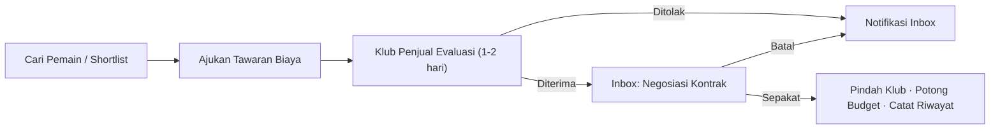

# Role:Senior Software Engineer
# Implementasikan Plan ini dan baca dengan seksama

# Futbol — Football Manager Simulation (Flutter)

Game simulasi manajer sepakbola berbasis **Flutter + Drift (SQLite) + Riverpod**, dengan liga **LALIGA EA SPORTS** dan **LALIGA HYPERMOTION**.

---

## Ringkasan Progres

- **Fase 1 (Selesai):** Fondasi dunia, generator klub/pemain/kontrak, sistem save SQLite (Drift v1), layar Start, New Career, Load Game, Skuad, dan Detail Pemain.
- **Fase 2 (Selesai):** Kalender & tombol **CONTINUE**, jadwal liga penuh (Berger), simulasi instan (Poisson), klasemen & form, Inbox dengan aksi blocking (target dewan, kontrak berakhir), keuangan bulanan & tiket, migrasi Drift v1 → v2.
- **Fase 3 (Rencana Aktif):** Simulasi pertandingan 2D gaya klasik FM, Taktik & Lineup, Pencarian Pemain di database, dan Pasar Transfer (jadwal Eropa) beserta aktivitas AI.

---

# Plan Fase 3 – Simulasi 2D, Taktik, Pencarian Pemain & Pasar Transfer

**Target akhir Fase 3:**
1. Laga tim kita dimainkan secara **live di tampilan 2D gaya klasik FM** (22 titik pemain + bola bergerak, kontrol kecepatan maksimal **2x**, komentar teks live, statistik, dan pergantian pemain di tengah laga).
2. Menu **Taktik** aktif untuk mengatur formasi, mentalitas, Starting XI, dan bangku cadangan.
3. Menu **Pencarian Pemain** aktif untuk mencari dan memfilter seluruh pemain di database.
4. **Pasar Transfer** terbuka sesuai **jadwal jendela transfer Eropa** (Musim Panas & Musim Dingin) lengkap dengan negosiasi beli/jual, daftar pantau (Shortlist), dan aktivitas transfer antar-klub AI.

---

## 1. Simulasi Pertandingan 2D (Gaya Klasik FM)

### 1.1 Tampilan & Kontrol (`MatchScreen`)
- **Kanvas Lapangan 2D (`CustomPainter`):**
  - Lapangan rumput bergaris 2D (105m × 68m dinormalisasi) lengkap dengan garis tengah, kotak penalti, dan gawang.
  - **22 titik (lingkaran) pemain** gaya klasik FM berwarna sesuai seragam klub (`primaryColor` / `secondaryColor`) dengan nomor punggung dan indikator nama saat menguasai bola.
  - Pergerakan bola (umpan, dribel, umpan silang, tembakan) dengan interpolasi halus.
- **Kontrol Pemutaran (Maksimal 2x):**
  - `Play / Pause`
  - Kecepatan **`1x`** dan **`2x`** *(maksimal 2x agar jalannya pertandingan tetap nyaman diikuti)*
  - `Skip ke Akhir` (menyelesaikan sisa menit laga langsung ke peluit akhir)
- **Komentar Live & Statistik:**
  - Feed komentar teks menit per menit (kick-off, peluang, tembakan, penyelamatan, **gol + assist**, pelanggaran, kartu kuning/merah, pergantian pemain, turun minum, full-time).
  - Statistik live: Penguasaan bola (%), Tembakan, Tepat Sasaran, Penyelamatan, Pelanggaran, Kartu.
- **Taktik & Subs di Tengah Laga:**
  - Ubah mentalitas (`Bertahan` / `Seimbang` / `Menyerang`) secara live.
  - Lakukan hingga **5 pergantian pemain (subs)** dari 7 pemain cadangan kapan saja selama pertandingan berlangsung; pemain masuk langsung menggantikan titik pemain di lapangan dan memengaruhi performa tim.

### 1.2 Match Engine 2D (`lib/domain/match/`)
- Deterministik menggunakan `SeededRandom` berbasis `(seed, fixtureId)`.
- Pergerakan titik pemain mengikuti slot formasi + posisi bola + mentalitas tim.
- Kelelahan pemain dihitung berdasarkan menit bermain aktual (starter penuh 12–22 kondisi, pemain pengganti proporsional, cadangan tidak main = 0).
- Setelah peluit akhir, `GameEngine.commitMatchResult(...)` menyimpan skor, kelelahan, moral, pendapatan tiket, serta laporan laga detail ke Inbox.
- Laga antar-klub AI tetap memakai simulasi instan agar **CONTINUE** tetap cepat.

---

## 2. Taktik & Lineup (`TacticsScreen`)

- **Formasi:** `4-4-2`, `4-3-3`, `4-2-3-1`, `3-5-2`, `5-3-2` lengkap dengan pratinjau posisi di lapangan 2D mini.
- **Mentalitas:** `Bertahan`, `Seimbang`, `Menyerang`.
- **Lineup:** 11 Starter + 7 Cadangan, mendukung tukar pemain antar-slot serta tombol **"Pilih Otomatis (Terbaik)"**.
- Disimpan di tabel `ClubTactics` sehingga susunan tim tetap tersimpan di file save.

---

## 3. Pencarian Pemain di Database (`PlayerSearchScreen`)

- Mencari dari seluruh pemain di database (LALIGA EA SPORTS, LALIGA HYPERMOTION, dan agen bebas).
- **Filter:**
  - Pencarian nama (live search)
  - Posisi / Grup posisi (`Semua`, `GK`, `Bek`, `Gelandang`, `Penyerang`, atau posisi spesifik)
  - Rentang Usia (min–maks) & Rentang CA (min–maks)
  - Nilai pasar maksimal
  - Status (`Semua`, `Daftar Jual`, `Kontrak Habis ≤ 6 Bln`, `Agen Bebas`)
  - Liga / Klub
- **Pengurutan:** CA, PA, Usia, Nilai Pasar, Gaji, Nama.
- Klik pemain → `PlayerDetailScreen` menampilkan klub saat ini, status daftar jual, dan tombol aksi (**Ajukan Tawaran**, **Shortlist**, atau **Daftar Jual** untuk pemain sendiri).

---

## 4. Pasar Transfer (Jadwal Eropa) & Aktivitasnya

### 4.1 Jendela Transfer Eropa
- **Jendela Musim Panas:** 1 Juli – 31 Agustus
- **Jendela Musim Dingin:** 1 Januari – 31 Januari
- Status jendela (Buka + sisa hari / Tutup + tanggal buka berikutnya) tampil jelas di halaman **Transfer**.

### 4.2 Alur Beli & Jual Pemain

- **Beli Pemain:**
  - Validasi biaya tawaran terhadap `transferBudget` dan `balance`.
  - Klub penjual (AI) mengevaluasi berdasarkan `marketValue`, sisa kontrak, status `isTransferListed`, dan reputasi klub pembeli.
  - Jika diterima → muncul aksi di Inbox untuk **Negosiasi Kontrak** (atur gaji & durasi 1–5 tahun) → jika pemain setuju, transfer selesai.
- **Jual Pemain & Tawaran Masuk AI:**
  - User dapat memasukkan pemain sendiri ke **Daftar Jual** (`isTransferListed`).
  - Selama jendela transfer buka, klub AI dapat mengajukan tawaran untuk pemain kita → masuk Inbox sebagai *blocking action* (**Terima** / **Tolak**).
- **Aktivitas Bursa AI:**
  - Setiap hari saat jendela transfer buka, AI juga melakukan transfer antar-klub sesuai kebutuhan posisi dan budget, tercatat di `TransferHistory` dan dapat dipantau di tab **Aktivitas Bursa**.

---

## 5. Perubahan Database (Drift v2 → v3)

| Tabel | Perubahan / Kolom |
|---|---|
| `Players` | + kolom `isTransferListed` (`Bool`, default `false`) |
| `ClubTactics` (baru) | `clubId` (PK), `formation`, `mentality`, `starterIds`, `subIds` |
| `TransferOffers` (baru) | `id` (auto), `playerId`, `fromClubId`, `toClubId`, `fee`, `status`, `createdDate`, `responseDate` |
| `TransferHistory` (baru) | `id` (auto), `date`, `playerId`, `playerName`, `fromClubId`, `toClubId`, `fee`, `type` |
| `Shortlist` (baru) | `playerId` (PK), `addedDate` |

- `schemaVersion = 3`. `onUpgrade` melakukan migrasi otomatis agar **save Fase 1 & Fase 2 tetap bisa dibuka**.
- Penambahan `InboxCategory.transfer` serta `InboxActionType.incomingTransferOffer` dan `InboxActionType.contractNegotiation`.

---

## 6. Rencana Daftar File

| Status | File | Isi |
|---|---|---|
| ✏️ ubah | `lib/domain/enums/inbox.dart` | Kategori `transfer` & aksi transfer/negosiasi kontrak |
| 🆕 | `lib/domain/enums/tactics.dart` | `Formation` (koordinat 2D slot), `Mentality` |
| 🆕 | `lib/domain/enums/transfer.dart` | `TransferOfferStatus`, `TransferType` |
| 🆕 | `lib/domain/models/match_models.dart` | `MatchEvent`, `MatchStats`, `PlayerDot`, `MatchFrame`, `MatchResultData`, `ClubTactic` |
| 🆕 | `lib/domain/models/transfer_models.dart` | `TransferOffer`, `TransferRecord`, `PlayerSearchFilter` |
| 🆕 | `lib/domain/match/match_engine_2d.dart` | Engine simulasi 2D (22 pemain + bola, komentar, statistik, subs live) |
| 🆕 | `lib/domain/transfer/transfer_window.dart` | Aturan jendela transfer Eropa, valuasi harga & ekspektasi gaji |
| ✏️ ubah | `lib/data/database/tables.dart`, `app_database.dart` | Skema v3 + migrasi v2 → v3 + `build_runner` |
| 🆕 | `lib/data/repositories/tactics_repository.dart` | Simpan/muat taktik & lineup |
| 🆕 | `lib/data/repositories/transfer_repository.dart` | Query tawaran, riwayat transfer, shortlist |
| ✏️ ubah | `lib/data/repositories/player_repository.dart`, `row_mappers.dart` | Pencarian pemain berfilter, toggle daftar jual, pindah klub |
| 🆕 | `lib/data/services/transfer_service.dart` | Ajukan tawaran, evaluasi AI, finalisasi kontrak, aktivitas harian AI |
| ✏️ ubah | `lib/data/services/game_engine.dart` | `commitMatchResult`, hook transfer harian AI, resolve aksi transfer |
| ✏️ ubah | `lib/app/providers.dart`, `game_actions.dart`, `router.dart` | Provider & rute `/tactics`, `/match`, `/transfer`, `/player-search` |
| 🆕 | `lib/features/tactics/tactics_screen.dart` | Layar atur formasi, mentalitas, starter & cadangan |
| 🆕 | `lib/features/match/match_screen.dart` & `pitch_2d_painter.dart` | Layar simulasi 2D gaya FM klasik (maks 2x), komentar, statistik, subs |
| 🆕 | `lib/features/transfer/transfer_screen.dart` | Tab **Cari Pemain**, **Shortlist**, **Tawaran**, **Aktivitas Bursa** |
| ✏️ ubah | `lib/features/player/player_detail_screen.dart` | Info klub + tombol Ajukan Tawaran / Shortlist / Daftar Jual |
| ✏️ ubah | `lib/features/dashboard/dashboard_screen.dart` | Aktifkan menu **Taktik** & **Transfer**, **MAINKAN LAGA** → `MatchScreen` 2D |
| ✏️ ubah | `lib/features/inbox/inbox_screen.dart` | UI terima/tolak tawaran transfer & dialog negosiasi kontrak |

---

## 7. Rencana Test & Kriteria Selesai

### Test
1. **Match Engine 2D:** deterministik untuk seed sama, skor wajar, statistik konsisten, subs live & ubah mentalitas berjalan tanpa error.
2. **Pencarian Pemain & Transfer:** filter akurat, aturan jendela Eropa valid (Jul–Agu & Jan), alur beli & jual mengubah klub, saldo, budget, dan mencatat `TransferHistory`.
3. **Migrasi DB v2 → v3:** save lama tetap terbaca utuh setelah upgrade skema.
4. `dart run build_runner build`, `flutter analyze`, dan `flutter test` semuanya lulus.

### Kriteria Selesai
- [ ] Atur formasi, mentalitas, starter & cadangan di **Taktik** lalu tersimpan di save
- [ ] Tekan **MAINKAN LAGA** → pertandingan berjalan di kanvas 2D titik pemain gaya klasik FM dengan kontrol `Play/Pause`, `1x`, `2x`, `Skip`, komentar live, dan subs di tengah laga
- [ ] Hasil laga 2D tersimpan ke klasemen, kondisi pemain, keuangan, dan Inbox
- [ ] Cari pemain lintas klub di database dengan filter & sort
- [ ] Saat jendela transfer Eropa buka (Jul–Agu / Jan): bisa menawar, negosiasi kontrak, membeli, menjual pemain, menerima tawaran AI, dan melihat aktivitas transfer liga
- [ ] Saat jendela transfer tutup: penawaran langsung terkunci dengan info tanggal buka berikutnya
