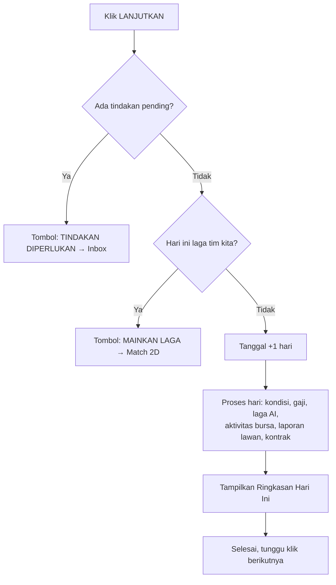
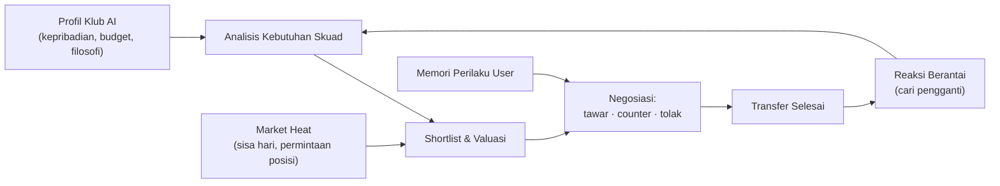
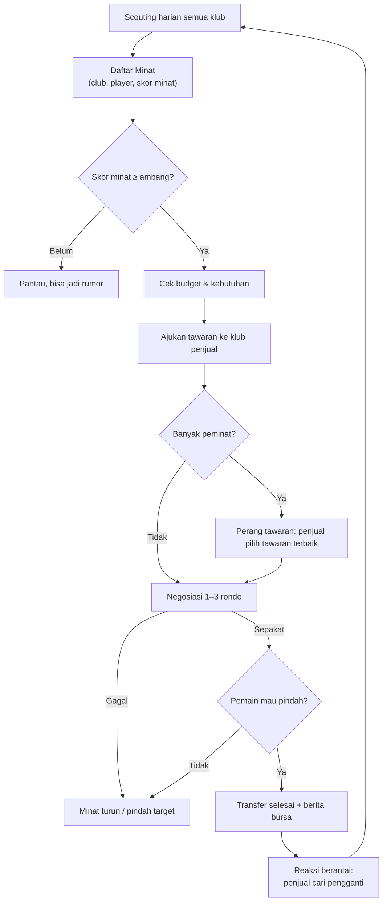

# Plan Fase 3 — CONTINUE H+1 & Bursa Transfer AI Adaptif

**Target:**
1. Tombol **LANJUTKAN** hanya memajukan **satu hari (H+1)** per klik. Tidak lagi melompat langsung ke hari pertandingan.
2. Selama jendela transfer Eropa masih buka (**1 Jul – 31 Agu** dan **1 – 31 Jan**), bursa transfer **terasa hidup**: klub AI aktif membeli dan menjual sesuai kebutuhan, menawarkan pemain ke klub kita, menawar pemain kita, dan **menyesuaikan strategi** dengan kondisi pasar serta perilaku user.

> [!NOTE]
> Plan ini melengkapi [README.md](README.md) (Match 2D, Taktik, Pencarian Pemain) dan [README_MATCH_RULES.md](README_MATCH_RULES.md). Semua keputusan AI deterministik dari `hash(seed, tanggal, clubId)` supaya hasilnya bisa diulang dan dites.

---

## Bagian A — LANJUTKAN = H+1

### A.1 Perilaku Baru



| Sebelum (Fase 2) | Sesudah (Fase 3) |
|---|---|
| Satu klik bisa maju sampai 120 hari | Satu klik = **tepat 1 hari** |
| Langsung berhenti di hari laga | Hari laga dicapai lewat klik harian. H-1 ada laporan lawan |
| Tidak ada ringkasan harian | Ada kartu **"Hari Ini"**: hasil laga AI, transfer, rumor, pesan baru |

- Pesan butuh tindakan tetap **memblokir** LANJUTKAN.
- Saat hari ini laga kita, tombol berubah menjadi **MAINKAN LAGA**.
- **Opsional (pengaturan):** tombol kecil sekunder **"Maju ke Laga Berikutnya ⏩"** tetap tersedia untuk pemain yang ingin cepat. Bawaannya dimatikan. Tombol ini tetap berhenti di setiap event penting (tindakan, tawaran masuk, deadline day).

### A.2 Perubahan Kode

| File | Perubahan |
|---|---|
| `lib/data/services/game_engine.dart` | Tambah `advanceOneDay()` yang mengembalikan `DayReport`. `continueGame()` dipertahankan untuk mode cepat dan test, lalu dibuat memanggil `advanceOneDay()` berulang |
| `lib/domain/models/season_models.dart` | Model `DayReport` berisi `date`, `aiResults`, `transfers`, `rumours`, `newMessages`, `stopReason?` |
| `lib/app/game_actions.dart` | `continueGame` → `advanceDay` (tanpa jeda 25 ms, cukup 1 transaksi) |
| `lib/features/dashboard/dashboard_screen.dart` | Label tombol **LANJUTKAN**, kartu **Hari Ini**, ticker bursa saat jendela buka |
| `test/` | Test Fase 2 "CONTINUE berhenti di laga pertama" diganti: "N klik H+1 mencapai hari laga pertama" |

---

## Bagian B — Bursa Transfer AI Adaptif

### B.1 Arsitektur



### B.2 Profil & Kepribadian Klub AI
Setiap klub mendapat profil saat musim dimulai. Profil diturunkan dari reputasi, saldo, dan seed.

| Kepribadian | Perilaku di Bursa |
|---|---|
| **Big Spender** | Mengejar pemain CA tinggi, berani membayar di atas nilai pasar, jarang menjual pemain inti |
| **Selling Club** | Mau menjual pemain bintang jika harga ≥ 120% nilai, lalu membeli pengganti murah |
| **Moneyball** | Mencari pemain *undervalued* (CA tinggi tapi nilai rendah, kontrak hampir habis) |
| **Youth Developer** | Memprioritaskan pemain ≤ 23 tahun dengan PA tinggi, menjual pemain veteran |
| **Survival Mode** | Klub saldo minus / zona degradasi. Menjual untuk menutup utang, membeli pinjaman dan agen bebas |

Atribut profil: `ambition`, `riskTolerance`, `negotiationSkill`, `sellingWillingness`, `youthFocus` (0–100).

### B.3 Analisis Kebutuhan Skuad (Adaptif)
Klub AI menilai ulang kebutuhannya setiap 3 hari (atau langsung setelah transfer/cedera):
- **Kedalaman per posisi:** jumlah pemain layak per grup (GK ≥ 2, Bek ≥ 7, Gelandang ≥ 6, Penyerang ≥ 4).
- **Gap kualitas:** CA starter dibanding rata-rata starter 6 besar liga.
- **Usia skuad:** posisi yang starternya ≥ 32 tahun mendapat prioritas peremajaan.
- **Kontrak:** pemain kunci dengan kontrak ≤ 12 bulan dijual sekarang atau diperpanjang.
- **Reaksi berantai:** jika klub AI kehilangan starter (dijual atau cedera panjang), kebutuhan posisi itu langsung naik ke **prioritas darurat**.

### B.4 Valuasi Pintar (Harga Dinamis)
```
Harga Minta = NilaiPasar
            × faktorUsia        (puncak 24–28, turun di atas 30)
            × faktorKontrak     (sisa ≤ 1 thn → 0,6 · ≥ 4 thn → 1,3)
            × faktorPeran       (inti 1,4 · rotasi 1,0 · cadangan 0,7)
            × faktorMarketHeat  (0,9–1,4)
            × faktorPenjual     (Selling Club 0,9 · Big Spender 1,5)
```
- **Market Heat:** naik jika banyak klub mencari posisi yang sama, dan naik tajam di **3 hari terakhir jendela (Deadline Day)**.
- **Ekspektasi gaji pemain:** dari CA, usia, reputasi klub tujuan, dan gaji saat ini (pindah ke klub lebih kecil menuntut gaji lebih tinggi).

### B.5 Negosiasi Multi-Ronde
- Maksimal **3 ronde**: Tawaran → Counter-offer AI → Tawaran final → Terima/Tolak.
- Komponen tawaran: **biaya**, **cicilan** (langsung / 2 / 3 tahun), **bonus penampilan**, dan **sell-on clause** (10–30%).
- AI dengan `negotiationSkill` tinggi memberi counter mendekati harga minta. AI yang sedang butuh uang (*Survival Mode*) lebih cepat menerima.
- Penolakan disertai alasan yang jelas, misalnya *"Pemain inti, tidak dijual di bawah €12 jt"* atau *"Kami belum punya pengganti"*.

### B.6 "Pintar Marketing" — AI Aktif Menjual & Membeli
Bursa terasa hidup karena AI **proaktif**, tidak hanya merespons:

| Aktivitas AI | Contoh di Inbox / Berita |
|---|---|
| **Menawarkan pemain ke klub kita** | *"Sevilla menawarkan Pérez (DC, 27) seharga €6 jt. Mereka tahu Anda kekurangan bek tengah."* |
| **Agen menawarkan klien** | *"Agen dari pemain bebas García (ST, 29) mencari klub. Gaji diminta €900 rb/thn."* |
| **Menawar pemain kita** | Tawaran masuk (blocking) dengan opsi **Terima / Tolak / Counter** |
| **Perang tawaran (bidding war)** | Jika user dan AI mengincar pemain yang sama, AI menaikkan tawaran dan user diberi tahu |
| **Memancing harga** | Klub penjual menyebar rumor *"3 klub tertarik"* untuk menaikkan harga pemain yang masuk daftar jual |
| **Cuci gudang** | Menjelang deadline, klub AI menurunkan harga pemain yang tak terpakai (diskon 20–40%) |
| **Panic buy** | Klub yang kebutuhan daruratnya belum terpenuhi saat H-2 deadline berani membayar mahal |

### B.7 AI Belajar dari Perilaku User
Tabel `MarketMemory` mencatat pola user dan AI menyesuaikan diri:
- **Sering menawar rendah:** klub AI menaikkan harga minta awal untuk klub kita (+5–15%).
- **Sering menjual pemain kita:** AI lebih sering mengirim tawaran untuk pemain kita.
- **Posisi yang sering dicari user:** klub penjual yang punya pemain di posisi itu menaikkan harga dan lebih rajin menawarkannya.
- **Reputasi negosiasi:** user yang konsisten menyelesaikan deal → AI lebih cepat merespons dan counter lebih lunak.

### B.8 Ritme Harian Bursa (Setiap H+1 di Jendela Transfer)

| Fase Jendela | Intensitas | Aktivitas Khas |
|---|---|---|
| **Minggu 1** | Rendah | Rumor, profil kebutuhan dibentuk, tawaran pembuka |
| **Pertengahan** | Sedang | Deal utama, reaksi berantai, perang tawaran |
| **H-7 s/d H-3** | Tinggi | Cuci gudang, tawaran ke klub user meningkat |
| **Deadline Day (H-2 s/d H-0)** | Sangat tinggi | Panic buy, ticker live, LANJUTKAN berhenti dengan banner **DEADLINE DAY** |

- Setiap hari: 0–3 transfer AI↔AI (bertambah mendekati deadline), 0–2 rumor, dan peluang tawaran masuk atau penawaran pemain ke user.
- Saat jendela **tutup**: semua negosiasi yang belum tuntas dibatalkan dan ringkasan bursa dikirim ke Inbox (*"Bursa ditutup: 47 transfer, rekor Real Madrid €80 jt"*).

### B.9 Batasan agar Realistis
- Skuad AI dijaga **min 22 / maks 30** pemain.
- Pengeluaran AI dibatasi `transferBudget` dan saldo, dan gaji baru dibatasi `wageBudget`.
- Satu pemain tidak bisa ditransfer dua kali dalam satu jendela.
- Klub AI tidak menjual > 3 starter dalam satu jendela kecuali sedang *Survival Mode*.

---

## Bagian B.10 — Minat & Transfer Antar Semua Klub

**Prinsip:** semua klub (**20 LALIGA EA SPORTS + 22 LALIGA HYPERMOTION + klub user**) adalah peserta bursa yang setara. Klub mana pun boleh berminat pada pemain dari klub mana pun. Jika penjual setuju dan pemain mau pindah, transfer terjadi, termasuk lintas liga.

### B.10.1 Matriks Transfer

| Pembeli ↓ / Penjual → | Klub AI LaLiga | Klub AI Hypermotion | Klub User | Agen Bebas |
|---|---|---|---|---|
| **Klub AI LaLiga** | ✅ | ✅ (sering, merekrut talenta) | ✅ tawaran masuk ke Inbox | ✅ |
| **Klub AI Hypermotion** | ✅ (pemain buangan / veteran) | ✅ | ✅ tawaran masuk ke Inbox | ✅ |
| **Klub User** | ✅ | ✅ | – | ✅ |

### B.10.2 Alur Minat → Transfer



### B.10.3 Skor Minat (0–100)
Setiap klub menghitung skor minat pada kandidat pemain dari klub lain:

```
Skor Minat = 35% · KecocokanKebutuhan   (posisi sesuai prioritas ClubNeeds)
           + 25% · PeningkatanKualitas  (CA kandidat vs starter saat ini)
           + 15% · KecocokanProfil      (usia/PA untuk Youth, value untuk Moneyball, dst.)
           + 15% · Keterjangkauan       (harga minta & gaji vs budget)
           + 10% · Peluang              (daftar jual, kontrak ≤ 12 bln, penjual butuh uang)
```

| Skor | Status | Efek |
|---|---|---|
| 0–39 | – | Diabaikan |
| 40–59 | **Memantau** | Masuk rumor ("X memantau Y"), user diberi tahu bila pemainnya dipantau |
| 60–79 | **Tertarik** | Siap menawar bila kebutuhan mendesak atau harga turun |
| 80–100 | **Target Utama** | Tawaran diajukan dalam 1–3 hari |

- Agar ringan, pencarian kandidat dibatasi: setiap klub hanya memindai pemain di **posisi prioritasnya** dalam rentang CA yang relevan. Kira-kira 1.000 pemain × 43 klub, dengan pemindaian bergilir 1/3 klub per hari.
- Skor minat **meluruh** 5 poin per minggu bila tidak ditindaklanjuti, dan naik bila pemain tampil bagus atau harganya turun.

### B.10.4 Kemauan Pemain (Player Willingness)
Kesepakatan antar-klub belum cukup, pemain juga harus mau pindah:
- **Naik kelas** (reputasi klub tujuan lebih tinggi, atau naik dari Hypermotion ke LaLiga): sangat mau.
- **Turun kelas** (ke Hypermotion / klub lebih kecil): hanya mau dengan gaji lebih tinggi, menit bermain terjamin, atau usia ≥ 31.
- **Menit bermain:** cadangan di klub besar mau pindah demi jadi starter.
- **Moral rendah** di klub sekarang membuatnya lebih mudah dibujuk.
- **Kontrak ≤ 6 bulan di jendela Januari:** pemain bisa menolak semua tawaran dan menunggu bebas transfer.

### B.10.5 Jenis Kesepakatan Antar-Klub

| Jenis | Kapan Dipakai |
|---|---|
| **Transfer permanen** | Bentuk utama |
| **Tukar pemain (swap) + uang** | Dua klub saling membutuhkan posisi yang dimiliki pihak lain |
| **Pinjaman (loan)** | Klub besar meminjamkan pemain muda ke Hypermotion untuk menit bermain |
| **Pembelian agen bebas** | Kontrak habis / pemain dilepas |
| **Klausul pelepasan (release clause)** | Pemain dengan klausul bisa direbut tanpa negosiasi bila klausul dibayar penuh (khas LaLiga) |

### B.10.6 Klub User dalam Ekosistem
- Klub user diperlakukan **sama seperti klub AI** sebagai penjual. Semua klub bisa berminat pada pemain kita.
- Pemberitahuan bertingkat:
  - *Memantau* → pesan berita (tidak memblokir).
  - *Tawaran resmi* → pesan blocking **Terima / Tolak / Counter**.
  - *Klausul pelepasan dibayar* → pemain langsung pindah, user hanya diberi tahu.
- User juga bisa melihat **siapa saja yang berminat pada pemainnya** di detail pemain (daftar klub + level minat).

### B.10.7 Persaingan & Keseimbangan
- **Perang tawaran:** bila ≥ 2 klub mengincar pemain yang sama, penjual menunggu 1–2 hari untuk mengumpulkan tawaran lalu memilih nilai terbaik (biaya + cicilan + reputasi pembeli).
- **Batas aktivitas per klub:** maks 6 pemain masuk dan 6 keluar per jendela. Ukuran skuad tetap 22–30.
- **Tidak ada transfer bolak-balik:** pemain yang baru pindah terkunci sampai jendela berikutnya.
- **Rival lokal:** transfer antar-rival (mis. Real Madrid ↔ Atlético, Betis ↔ Sevilla) dikenai harga +30% dan peluang tolak lebih tinggi.

---

## Bagian C — Perubahan Database (Drift v2 → v3)

| Tabel | Kolom Utama |
|---|---|
| `Players` (+kolom) | `isTransferListed`, `askingPrice?`, `releaseClause?`, `lockedUntil?`, `loanFromClubId?` |
| `TransferInterests` | `clubId`, `playerId`, `score` (0–100), `level` (watching / interested / target), `updatedDate` |
| `ClubAiProfiles` | `clubId` (PK), `personality`, `ambition`, `riskTolerance`, `negotiationSkill`, `sellingWillingness`, `youthFocus` |
| `ClubNeeds` | `clubId`, `positionGroup`, `priority` (0–100), `updatedDate` |
| `TransferOffers` | `id`, `playerId`, `fromClubId`, `toClubId`, `fee`, `installmentYears`, `sellOnPct`, `round`, `status`, `createdDate`, `expiresDate`, `reason?` |
| `TransferHistory` | `id`, `date`, `playerId`, `playerName`, `fromClubId`, `toClubId`, `fee`, `type` |
| `TransferNews` | `id`, `date`, `kind` (rumour / deal / offer / deadline), `text`, `clubIds` |
| `MarketMemory` | `key` (mis. `lowballCount`, `pos:DC`), `value` |
| `Shortlist` | `playerId` (PK), `addedDate` |

`schemaVersion = 3`, dengan migrasi aman sehingga save Fase 1 dan 2 tetap bisa dibuka.

---

## Bagian D — Daftar File

| Status | File | Isi |
|---|---|---|
| 🆕 | `lib/domain/transfer/transfer_window.dart` | Status jendela, sisa hari, fase jendela, Deadline Day |
| 🆕 | `lib/domain/transfer/club_ai_profile.dart` | Kepribadian dan pembentukan profil dari seed |
| 🆕 | `lib/domain/transfer/squad_needs_analyzer.dart` | Kedalaman, gap kualitas, usia, kontrak, kebutuhan darurat |
| 🆕 | `lib/domain/transfer/valuation.dart` | Harga minta dinamis dan ekspektasi gaji |
| 🆕 | `lib/domain/transfer/negotiation_ai.dart` | Evaluasi tawaran, counter-offer, alasan penolakan |
| 🆕 | `lib/domain/transfer/market_heat.dart` | Indeks permintaan posisi dan multiplier deadline |
| 🆕 | `lib/domain/transfer/interest_engine.dart` | Skor minat, peluruhan, level minat, pemindaian bergilir semua klub |
| 🆕 | `lib/domain/transfer/player_willingness.dart` | Keputusan pemain: naik/turun kelas, menit bermain, gaji, moral |
| 🆕 | `lib/domain/transfer/deal_types.dart` | Permanen, swap, pinjaman, agen bebas, klausul pelepasan |
| 🆕 | `lib/data/services/transfer_market_service.dart` | Loop harian bursa: transfer AI↔AI, tawaran ke user, rumor, reaksi berantai |
| 🆕 | `lib/data/repositories/transfer_repository.dart` | Offers, history, news, shortlist, memory |
| ✏️ | `lib/data/services/game_engine.dart` | `advanceOneDay()`, hook bursa harian, resolve aksi transfer |
| ✏️ | `lib/data/database/tables.dart`, `app_database.dart` | Tabel v3 dan migrasi |
| ✏️ | `lib/domain/enums/inbox.dart` | `InboxCategory.transfer`, aksi `incomingOffer`, `counterOffer`, `contractNegotiation`, `playerOffered` |
| 🆕 | `lib/features/transfer/transfer_screen.dart` | Tab **Bursa Hari Ini**, **Cari Pemain**, **Shortlist**, **Negosiasi**, **Riwayat** |
| ✏️ | `lib/features/dashboard/dashboard_screen.dart` | Tombol LANJUTKAN H+1, kartu Hari Ini, ticker dan countdown deadline |

---

## Bagian E — Test & Kriteria Selesai

### Test
1. **H+1:** satu panggilan `advanceOneDay()` memajukan tanggal tepat 1 hari. Jumlah klik dari 1 Jul sampai laga pertama = selisih hari.
2. **Blocking:** tindakan pending → tanggal tidak berubah.
3. **Valuasi:** pemain kontrak ≤ 1 tahun lebih murah, harga naik saat Deadline Day.
4. **Negosiasi:** tawaran di bawah 70% harga minta ditolak, 85–99% mendapat counter, ≥ harga minta diterima (kecuali pemain inti tanpa pengganti).
5. **Bursa hidup:** simulasi 62 hari jendela musim panas menghasilkan transfer AI↔AI > 0, skuad AI tetap 22–30, tidak ada saldo AI yang melewati batas.
6. **Adaptif:** setelah 3 kali lowball, harga minta awal ke klub user naik.
7. **Determinisme:** seed sama → urutan transfer identik.
8. **Semua klub saling transfer:** simulasi 1 jendela penuh menghasilkan transfer di keempat arah (LaLiga↔LaLiga, LaLiga↔Hypermotion, Hypermotion↔Hypermotion, AI↔User). Tidak ada pemain yang pindah dua kali dalam satu jendela.
9. **Kemauan pemain:** pemain inti LaLiga menolak pindah ke Hypermotion tanpa kenaikan gaji besar. Cadangan mau pindah demi menit bermain.
10. **Perang tawaran:** dua peminat → penjual memilih tawaran bernilai tertinggi.
11. **Migrasi v2 → v3** lulus. `build_runner`, `flutter analyze`, dan `flutter test` hijau.

### Kriteria Selesai
- [ ] Setiap klik **LANJUTKAN** = H+1 dengan kartu ringkasan hari
- [ ] Hari laga dicapai lewat klik harian, lalu tombol menjadi **MAINKAN LAGA**
- [ ] Selama jendela buka, ada transfer AI↔AI, rumor, dan tawaran masuk/keluar hampir setiap hari
- [ ] Klub AI punya kepribadian berbeda dan bereaksi berantai setelah kehilangan pemain
- [ ] Negosiasi multi-ronde dengan counter-offer dan alasan
- [ ] Deadline Day terasa berbeda (ticker, intensitas tinggi, panic buy, cuci gudang)
- [ ] AI menyesuaikan harga dengan perilaku user
- [ ] Jendela tutup → negosiasi dibatalkan dan ringkasan bursa masuk Inbox
- [ ] Semua 43 klub bisa saling berminat dan saling transfer (lintas liga, swap, pinjaman, klausul pelepasan)
- [ ] User bisa melihat klub mana saja yang berminat pada pemainnya, dan menerima tawaran dari klub mana pun
