# Plan — Kalender Musim Eropa Multi-Musim (2026/27 → 2027/28 → …)

**Target:**
1. Karier baru dimulai pada **musim Eropa 2026/27**, mulai **Agustus 2026** dan berakhir **Mei 2027**.
2. Setelah musim selesai, game **otomatis lanjut ke musim 2027/28**, lalu 2028/29, dan seterusnya tanpa batas, dengan tombol **LANJUTKAN H+1** yang sama.

> [!NOTE]
> Saat ini tanggal masih di-hardcode ke 2025: `WorldGenerator.seasonStart = 1 Jul 2025`, `SeasonCalendar.firstRound = 16 Agu 2025`, kontrak awal `2026 + rng`, dan fallback `DateTime.utc(2025, 7, 1)` di beberapa layar. Plan ini mengganti semuanya dengan **kalender berbasis tahun musim** (`seasonStartYear`). Fitur pergantian musim, promosi/degradasi, dan regen, yang semula dijadwalkan untuk Fase 5, **dimajukan** ke plan ini dalam versi dasar.

---

## 1. Siklus Satu Musim

```mermaid
flowchart LR
    A["1 Agu 2026<br/>Karier dimulai<br/>(pra-musim, bursa buka)"] --> B["15 Agu 2026<br/>Pekan 1"]
    B --> C["31 Agu<br/>Bursa musim panas tutup"]
    C --> D["22 Des – 2 Jan<br/>Libur musim dingin"]
    D --> E["1–31 Jan 2027<br/>Bursa musim dingin"]
    E --> F["Mei 2027<br/>Pekan terakhir + playoff"]
    F --> G["31 Mei<br/>Musim selesai"]
    G --> H["Juni<br/>Off-season"]
    H --> I["1 Jul 2027<br/>Musim 2027/28 dibuat"]
    I --> B2["Pekan 1 musim 2027/28"]
```

### 1.1 Kalender Musim 2026/27 (Musim Pertama)

| Tanggal | Event |
|---|---|
| **Sab, 1 Agu 2026** | Karier dimulai. Sambutan dewan + target musim. Bursa musim panas masih buka (sisa 31 hari) |
| **Sab, 15 Agu 2026** | Pekan 1 LALIGA EA SPORTS dan LALIGA HYPERMOTION |
| **Sen, 31 Agu 2026** | Bursa musim panas ditutup |
| **22 Des 2026 – 2 Jan 2027** | Libur musim dingin (tidak ada laga) |
| **1 Jan 2027** | Keputusan kontrak yang habis 30 Juni |
| **1–31 Jan 2027** | Bursa musim dingin |
| **Sab/Min, 15–16 Mei 2027** | Pekan reguler terakhir LaLiga (38 pekan) dan Hypermotion (42 pekan) |
| **Rab 19 & Min 23 Mei 2027** | Semifinal playoff promosi Hypermotion (peringkat 3–6, dua leg) |
| **Rab 26 & Min 30 Mei 2027** | Final playoff promosi (dua leg) |
| **Sen, 31 Mei 2027** | **Musim selesai**: ringkasan musim, penghargaan, evaluasi dewan |

### 1.2 Off-season & Pergantian Musim

| Tanggal | Event |
|---|---|
| **1 Jun** | Promosi/degradasi diterapkan, arsip klasemen disimpan |
| **Juni** | Off-season. LANJUTKAN H+1 tetap jalan (berita, rumor bursa, perpanjangan kontrak) |
| **30 Jun** | Kontrak habis → pemain menjadi **agen bebas** |
| **1 Jul** | **Musim baru dibuat** (lihat Bagian 3). Bursa musim panas buka |
| **Juli – pertengahan Agu** | Pra-musim, bursa transfer aktif |
| **Sabtu pertama ≥ 15 Agu** | Pekan 1 musim baru |

> [!IMPORTANT]
> Karier baru selalu dimulai **1 Agustus** pada musim pertama, sesuai permintaan. Musim berikutnya dimulai **1 Juli** supaya off-season dan bursa musim panas berjalan penuh selama 2 bulan.

---

## 2. Aturan Kalender Dinamis (`SeasonCalendar`)

Semua tanggal dihitung dari `seasonStartYear` (2026 untuk musim 2026/27). Tidak ada lagi tahun yang di-hardcode.

| Aturan | Rumus |
|---|---|
| **Label musim** | `"$y/${(y+1) % 100}"` → `2026/27` |
| **Awal karier (musim pertama)** | `1 Agu y` |
| **Awal musim (musim berikutnya)** | `1 Jul y` |
| **Pekan 1** | Sabtu pertama ≥ `15 Agu y` (2026 → 15 Agu, 2027 → 21 Agu) |
| **Libur musim dingin** | `22 Des y` – `2 Jan y+1` |
| **Batas pekan terakhir LaLiga** | Minggu terakhir bulan Mei `y+1` |
| **Batas pekan terakhir Hypermotion** | Minggu terakhir Mei − 14 hari (memberi ruang 4 tanggal playoff) |
| **Bursa transfer** | `1 Jul – 31 Agu y` dan `1 – 31 Jan y+1` |
| **Akhir musim** | `31 Mei y+1` |

### 2.1 Laga Tengah Pekan (Midweek) Otomatis
Pekan per minggu saja tidak cukup untuk Hypermotion (42 pekan) agar selesai di bulan Mei:
- `SeasonCalendar.build(startYear, rounds, deadline)` menghitung jumlah akhir pekan yang tersedia (setelah dikurangi libur musim dingin).
- Jika `rounds > akhir pekan tersedia`, kekurangannya diisi **pekan Rabu (midweek)** yang disebar merata (tidak di 3 pekan pertama/terakhir, tidak di libur musim dingin, dan tidak berdekatan dengan midweek lain).
- Contoh 2026/27: LaLiga 38 pekan → 38 akhir pekan, selesai 15–16 Mei. Hypermotion 42 pekan → 38 akhir pekan + **4 midweek**, selesai 16 Mei.
- Laga dalam satu pekan tetap dibagi rata ke Sabtu dan Minggu (atau Selasa–Rabu untuk midweek).

---

## 3. Pergantian Musim Otomatis (`SeasonRollover`)

Dijalankan saat LANJUTKAN mencapai **1 Juli**, dalam satu transaksi database:

1. **Arsip musim lama:** klasemen akhir, juara, top skor, dan posisi klub user disimpan ke `SeasonArchive`. Fixtures musim lama dihapus (cukup simpan arsip) agar file save tetap kecil.
2. **Promosi & degradasi:**
   - LaLiga: **3 terbawah** turun ke Hypermotion.
   - Hypermotion: **peringkat 1–2** promosi langsung, plus **pemenang playoff** (peringkat 3–6).
   - Hypermotion: **4 terbawah** turun ke *Primera Federación* (pool klub non-simulasi), diganti **4 klub** yang naik dari pool tersebut.
3. **Pemain:**
   - Usia +1.
   - Perkembangan/penurunan CA: pemain muda dengan PA tinggi naik, usia ≥ 31 mulai menurun, dipengaruhi menit bermain musim lalu.
   - Nilai pasar dihitung ulang.
   - Pemain usia ≥ 34–38 dengan CA rendah bisa **pensiun** (masuk berita).
4. **Regen / Youth Intake:** setiap klub mendapat 2–5 pemain muda (16–18 tahun) baru, kualitasnya berdasarkan reputasi klub, agar jumlah pemain dan kualitas liga tetap stabil.
5. **Keuangan:** budget transfer dan gaji musim baru ditetapkan dari posisi akhir, hadiah uang liga, dan saldo. Klub promosi/degradasi mendapat penyesuaian.
6. **Jadwal musim baru** dibuat dari `hash(seed, seasonStartYear)`, jadi deterministik tetapi berbeda tiap musim.
7. **Inbox:** pesan dewan untuk target musim baru (blocking: "Terima target"), ringkasan promosi/degradasi, dan daftar pemain yang pensiun.
8. **Evaluasi manajer:** jika target dewan gagal jauh (mis. degradasi saat target papan tengah), dewan bisa memberi peringatan. Pemecatan ditunda ke fase berikutnya.

---

## 4. Perubahan Database (Drift v3 → v4)

| Tabel | Perubahan |
|---|---|
| `GameStates` (+kolom) | `seasonStartYear` (int, mis. 2026) |
| `Seasons` (baru) | `startYear` (PK), `label`, `startDate`, `endDate`, `status` (active / finished) |
| `Fixtures` (+kolom) | `seasonStartYear`, `stage` (league / playoffSemi / playoffFinal), `leg?` |
| `SeasonArchive` (baru) | `seasonStartYear`, `leagueId`, `clubId`, `position`, `played`, `won`, `drawn`, `lost`, `gf`, `ga`, `points` |
| `Honours` (baru) | `seasonStartYear`, `leagueId`, `type` (champion / promoted / playoffWinner / relegated / topScorer), `clubId`, `playerId?` |
| `Leagues` | Tambah liga pool `primera_federacion` (non-simulasi, `isSimulated = false`) |

**Migrasi save lama (v3 → v4):**
- Save lama yang masih bertanggal 2025 diberi `seasonStartYear = 2025` (musim 2025/26) dan tetap dimainkan sampai selesai, lalu rollover normal ke 2026/27.
- Karier **baru** selalu dimulai **1 Agu 2026** pada musim 2026/27.

---

## 5. Daftar File

| Status | File | Isi |
|---|---|---|
| ✏️ | `lib/domain/season/season_calendar.dart` | `SeasonCalendar.forYear(y)`: pekan 1, libur, deadline, midweek otomatis, label musim |
| 🆕 | `lib/domain/season/season_dates.dart` | Konstanta tanggal penting per musim (awal karier, awal musim, akhir musim, bursa) |
| 🆕 | `lib/domain/season/playoff_generator.dart` | Bracket playoff Hypermotion (3v6, 4v5, dua leg, final) |
| 🆕 | `lib/domain/season/player_development.dart` | Usia +1, perkembangan/penurunan CA, pensiun |
| 🆕 | `lib/domain/generators/youth_intake.dart` | Regen pemain muda per klub |
| 🆕 | `lib/data/services/season_rollover_service.dart` | Arsip, promosi/degradasi, pemain, regen, keuangan, jadwal baru, inbox |
| ✏️ | `lib/domain/generators/world_generator.dart` | `seasonStart = 1 Agu 2026`, kontrak awal berakhir `30 Jun 2027 + rng(0..4)`, usia dihitung per 2026 |
| ✏️ | `lib/data/services/game_engine.dart` | Status `seasonOver` → off-season (tidak lagi berhenti permanen), memicu rollover 1 Juli, fixture difilter per musim |
| ✏️ | `lib/domain/transfer/transfer_window.dart` | Jendela dihitung dari `seasonStartYear` |
| ✏️ | `lib/data/services/transfer_service.dart` | Ganti `DateTime.utc(2025)` → acuan musim aktif |
| ✏️ | `player_detail_screen.dart`, `player_search_view.dart`, `transfer_screen.dart` | Hapus fallback `DateTime.utc(2025, 7, 1)`, pakai tanggal dari `GameState` |
| ✏️ | `lib/data/database/tables.dart`, `app_database.dart` | Skema v4 + migrasi |
| ✏️ | `lib/features/dashboard/dashboard_screen.dart` | Label musim (mis. **Musim 2026/27**), status Off-season / Pra-musim / Bursa |
| ✏️ | `lib/features/fixtures/fixtures_screen.dart` | Pilihan musim: klasemen musim berjalan + arsip musim lalu, tab Playoff |
| 🆕 | `lib/features/history/club_history_screen.dart` | Riwayat musim dan gelar klub (dari `SeasonArchive` + `Honours`) |

---

## 6. Test

1. **Kalender 2026/27:** pekan 1 = Sab 15 Agu 2026. LaLiga 38 pekan selesai ≤ 30 Mei 2027. Hypermotion 42 pekan selesai ≤ 16 Mei 2027 dan playoff ≤ 30 Mei 2027. Tidak ada laga 22 Des – 2 Jan.
2. **Kalender 2027/28:** pekan 1 = Sab 21 Agu 2027. Semua laga selesai sebelum 1 Jun 2028.
3. **Midweek otomatis:** jumlah midweek = pekan − akhir pekan tersedia. Tidak ada tim bermain dua kali di hari yang sama.
4. **Karier baru:** `currentDate = 1 Agu 2026`, label `2026/27`, kontrak awal tidak ada yang berakhir sebelum 30 Jun 2027.
5. **Rollover:** setelah 1 Jul 2027 → `seasonStartYear = 2027`, 3 klub LaLiga turun, 3 naik (2 langsung + 1 playoff), Hypermotion tetap 22 klub, LaLiga tetap 20 klub, usia pemain +1, jadwal baru lengkap (380 + 462 laga).
6. **Multi-musim:** simulasi otomatis 3 musim penuh (2026/27 → 2029/30) tanpa error. Jumlah pemain per klub tetap 22–30, arsip berisi 3 musim.
7. **Migrasi:** save v3 bertanggal 2025 terbuka, tetap jalan, lalu rollover ke 2026/27.
8. `build_runner`, `flutter analyze`, dan `flutter test` hijau.

## 7. Kriteria Selesai

- [ ] Karier baru dimulai **Sabtu, 1 Agustus 2026**, label **Musim 2026/27**
- [ ] Pekan 1 tanggal 15 Agu 2026, musim reguler dan playoff selesai **Mei 2027**
- [ ] Juni berjalan sebagai off-season dengan LANJUTKAN H+1
- [ ] 1 Juli 2027 musim **2027/28** otomatis dibuat: promosi/degradasi, usia +1, regen, budget, dan jadwal baru
- [ ] Siklus berlanjut terus ke 2028/29, 2029/30, dan seterusnya
- [ ] Arsip klasemen dan riwayat gelar bisa dilihat per musim
